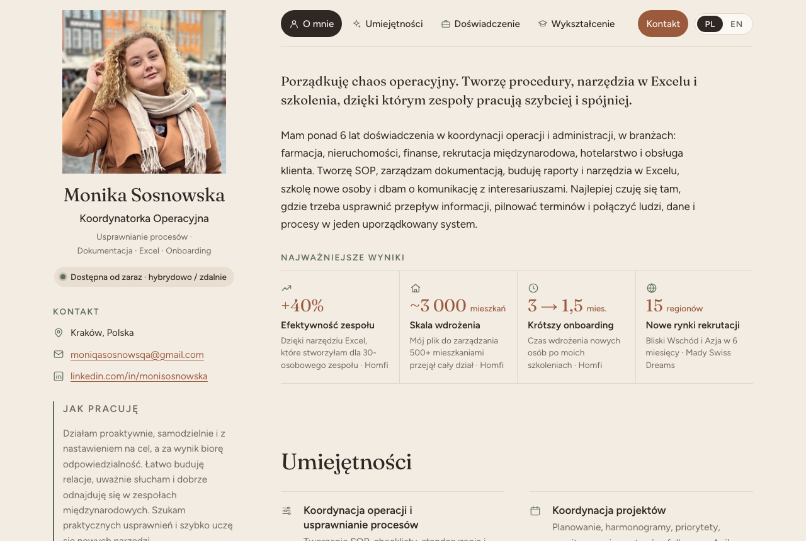

# Monika Sosnowska · Portfolio Website

My personal portfolio: a one-page website that presents my experience as an **Operations Coordinator** to recruiters, in **Polish and English**.

**Live site:** [ladysosenka.github.io/portfolio-website](https://ladysosenka.github.io/portfolio-website/) · English version: [?lang=en](https://ladysosenka.github.io/portfolio-website/?lang=en)



## What it does

- Shows my profile, key results, skills, tools, experience and education on one page.
- Switches between **Polish and English** with one click. A link ending in `?lang=en` opens the English version directly.
- Highlights the section you are reading in the top menu.
- Works on laptops and phones, and prints cleanly.
- Shows a tidy preview (title and description) when the link is shared on LinkedIn.

## Built with

| Part | Technology |
|---|---|
| Structure and content | HTML |
| Layout and design | CSS (grid, flexbox, custom properties) |
| Language switch and menu highlight | Plain JavaScript (`IntersectionObserver`, `localStorage`) |
| Icons | Inline SVG |
| Fonts | Fraunces and Figtree (Google Fonts) |

No frameworks and no build step: the whole site is one `index.html` file plus a photo.

## How to run it

1. Download or clone this repository:
   ```bash
   git clone https://github.com/ladysosenka/portfolio-website.git
   ```
2. Open `index.html` in any web browser. That's it.

## Project structure

```
portfolio-website/
├── index.html        ← the whole website: content (HTML), design (CSS), behaviour (JavaScript)
├── avatar.jpg        ← profile photo
├── docs/
│   └── screenshot.png  ← image used in this README
├── .gitignore        ← files Git should never upload
└── README.md         ← this page
```

## Design decisions

- **Scandinavian, minimal, "hygge" style.** Warm linen background, espresso text, a cinnamon accent and soft sage icons. Thin lines instead of boxes.
- **Recruiter-first order.** Who I am and my availability come first, then results in numbers, skills, experience and education, then contact.
- **Results with context.** Every number says what changed and where, for example *"+40% team efficiency thanks to an Excel tool I built for a team of 30 (Homfi)"*.
- **Keywords from my CV.** Skill names match the phrases recruiters search for, such as SOP development, stakeholder management and Excel reporting.

## What I learned

This is my first coding project. Building it, I learned:

- how **HTML, CSS and JavaScript** work together;
- **design tokens** (CSS custom properties) to change colours and sizes in one place;
- **CSS Grid and Flexbox** for layouts that adapt to phones;
- how to write **bilingual content** with a simple language switch;
- **accessibility basics**: image `alt` text, keyboard focus styles, `aria-current`, respecting reduced-motion settings;
- **Git and GitHub**: commits, `.gitignore`, publishing a repository and a live site.

## Contact

- Email: moniqasosnowsqa@gmail.com
- LinkedIn: [linkedin.com/in/monisosnowska](https://www.linkedin.com/in/monisosnowska/)

---

© Monika Sosnowska. The code is free to look at and learn from. The text and photo are personal: please don't reuse them.
